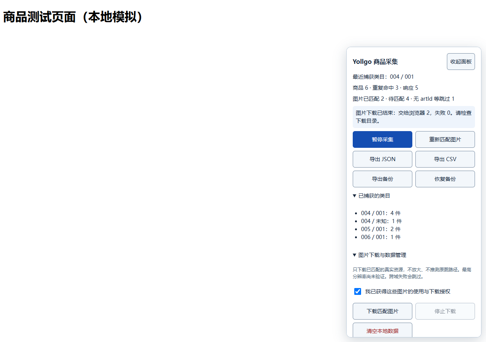

# Yollgo 商品被动采集助手

在已登录、且有权访问的 [app.yollgo.com](https://app.yollgo.com/) 页面运行的 Tampermonkey 脚本。仅被动监听网页自然发起的商品请求，固定支持店铺 `6085`。

## 安装

1. 安装 [Tampermonkey](https://www.tampermonkey.net/)。
2. 点击 **[安装油猴脚本](https://raw.githubusercontent.com/wuy705464-ai/yollgo-collector/main/yollgo-collector.user.js)**，在油猴页面确认安装。
3. 登录网站并完整刷新。手动打开类目 `004`，检查右下角计数，导出 JSON/CSV 核对。

如果浏览器仅展示代码，请在 Tampermonkey 管理面板中新建脚本，将全部代码粘贴进去并保存，再刷新网站。按浏览器提示开启用户脚本运行权限。

安装地址也是脚本的更新地址。后续发布新版本时会递增 `@version`，可通过 Tampermonkey 检查更新。

## 功能

- Fetch/XHR 响应监听，不自行重放商品 API，不修改网站请求。
- 提取 `articulo_lists` 中的商品，保留业务字段、类目来源、首次/最近采集时间。
- 按 `artId` 去重，手动切换类目后自动累积；IndexedDB 保存进度。
- 面板显示最近捕获类目、商品数、重复次数、图片匹配状态与类目统计。
- 暂停/恢复、清空本地数据、CSV/JSON 导出及备份恢复。
- 根据网页实际加载的图片资源和明确证据匹配 URL；无法准确关联时保持待匹配。
- 获得图片使用授权后下载已匹配资源，保存原始字节。

## 数据边界

只监听 `POST https://ssl.freex.es/api/articulos/6085`；不枚举其他店铺、不自动点击类目或业务按钮。请通过网站正常流程浏览、翻页、滚动加载。

不读取或导出 Cookie、请求认证头、API Key、签名；仅投影 `shopid`、`muluid`、`submuluid` 三个业务参数。商品 `raw` 会过滤常见敏感字段和凭据文本，不保存响应外围对象。

图片 URL 必须实际观察到且具备商品关联证据。带查询参数的 URL 保守忽略，不推测 CDN 地址或最高分辨率母图。下载不携带认证信息，跨域限制可能导致失败。

## 使用说明与验证

- [安装、完整测试方法和故障排查](使用说明.txt)
- [本地自动测试报告](测试结果.txt)
- [自动测试源码](verification/test-collector.cjs)
- [自动测试运行说明](verification/自动测试说明.txt)

已经通过本地 Chrome 模拟页面的 11 组自动测试，包括实际文件下载、数据库续存、跨类目去重、暂停与在途响应、图片歧义撤销、无认证图片下载和备份恢复。尚未使用真实登录会话验证线上 API 与 Tampermonkey 扩展注入，请先验收类目 `004`，再继续其他类目。



## 运行自动测试

需要 Node.js、Chrome 和 Playwright。在仓库根目录执行：

```powershell
npm install --prefix work/qa playwright
$env:PLAYWRIGHT_MODULE = (Resolve-Path 'work/qa/node_modules/playwright').Path
node verification/test-collector.cjs
```

测试使用本地模拟响应，不访问真实商品 API。模拟备份、截图与报告写入 `work/verification/`。仅在自己的授权访问范围内采集和使用商品及图片。
